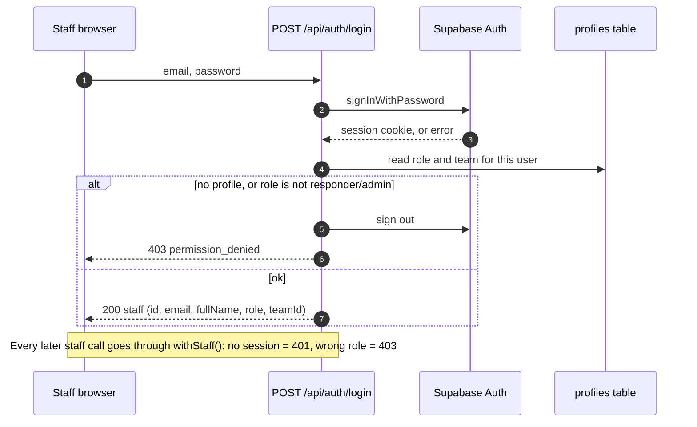
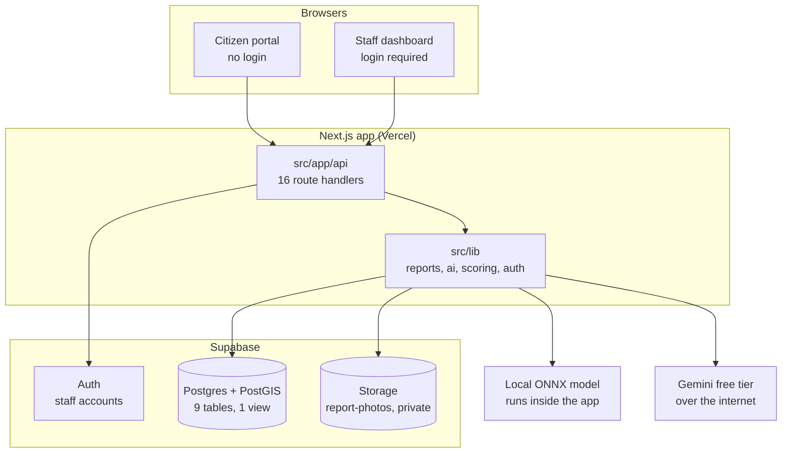
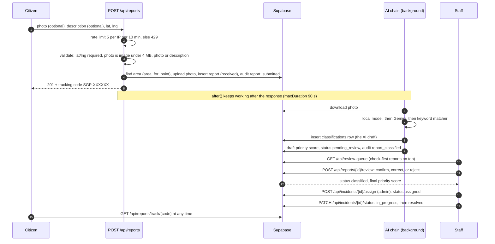
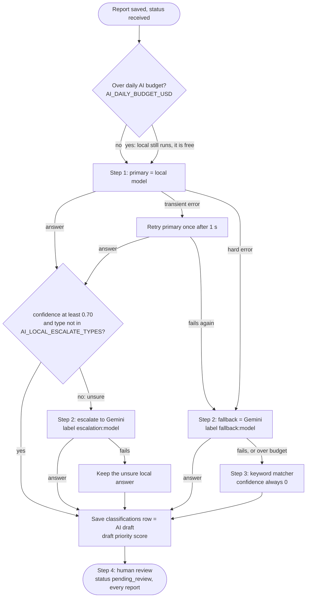
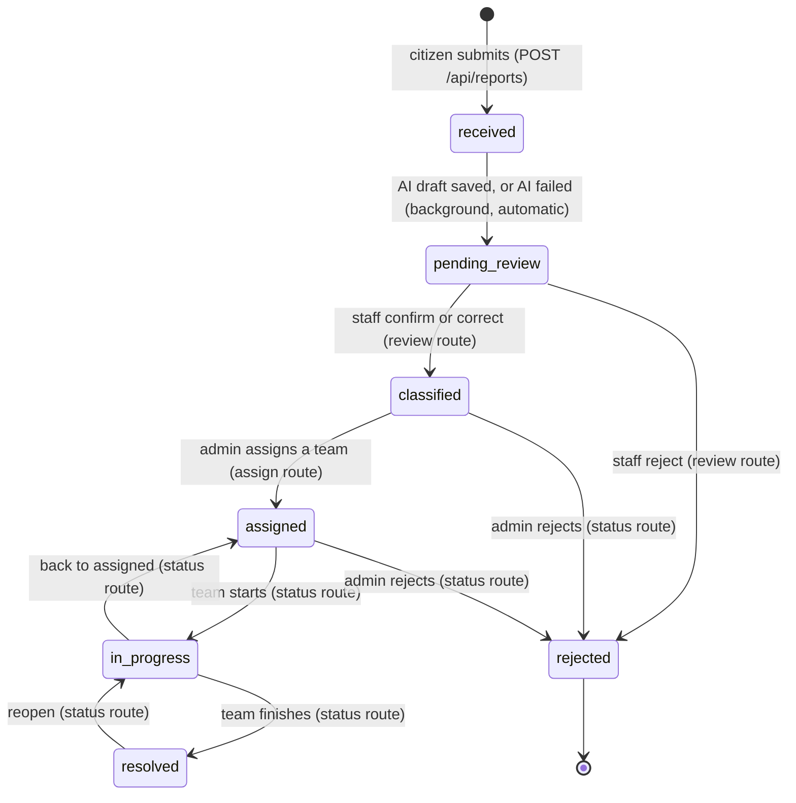
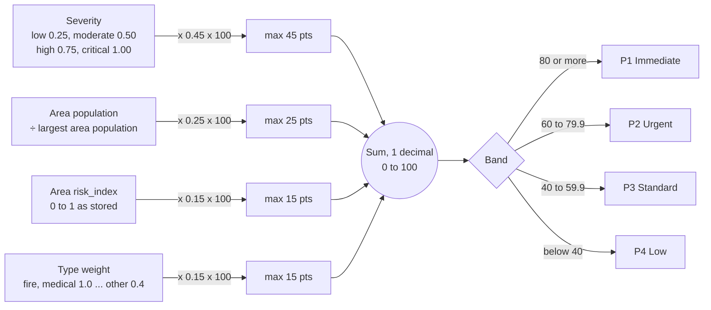
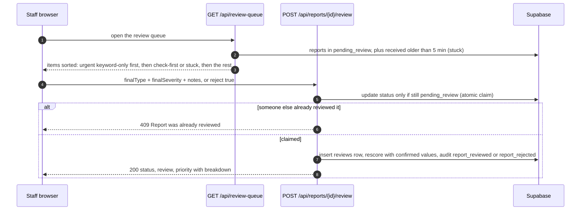
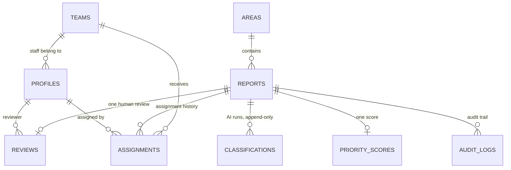

# SAGIP-AI – Backend Technical Handoff

| Metadata | Details |
|---|---|
| Document owner (PM) | rye (Ricabo, AI integration) |
| Tech lead / backend lead | Fabroa (backend) |
| Status | **Draft** |
| Target release | Final presentation and defense, 2026-11-23 (the project goal says 2026-11-24, see open item OI-01) |
| Base branch | `dev` (this document was checked against `dev` at commit `579a279`, 2026-11-21) |
| Design / wireframes | Not linked yet (OI-02) |
| Tracking | Team tracker sheet "SAGIP-AI_CCRVibe2.0" (Progress Checklist, Risk Log, Issue Log tabs) and the GitHub Projects board |
| Related docs | [DOCUMENTATION.md](DOCUMENTATION.md), [priority-weights.md](priority-weights.md), [local-severity-design.md](local-severity-design.md), [handoffs/ai-benchmarking.md](handoffs/ai-benchmarking.md) |

**How to read this document.** Sections 1 to 3 explain *why* and *who*. Section 4 is the picture of the whole system: read it before anything else. Sections 5 to 9 are the exact rules, fields and endpoints. Sections 10 and 11 cover limits and launch. Anything we do not know yet is in the **Open items** table at the end, with an owner. Nothing in this document is a guess: every rule points to the file it comes from.

**Counted from the repo (not from memory):**

| What | Count | How it was counted |
|---|---|---|
| API endpoints | **16** | 16 `route.ts` files under `src/app/api`, each exporting exactly one HTTP method |
| Database migrations | **7** | `supabase/migrations/0001` to `0007` |
| Database tables | **9** | `create table` statements in `0001_init.sql` (no later migration adds a table) |
| Database views | **1** | `incidents` (migration 0003) |
| Audit log action names | **10** | Every `action:` value written to `audit_logs` in `src/` |

---

## Table of contents

1. [Overview and objectives](#1-overview-and-objectives)
2. [Scope](#2-scope)
3. [User roles and permissions matrix](#3-user-roles-and-permissions-matrix)
4. [Flowcharts and state diagrams](#4-flowcharts-and-state-diagrams)
5. [Functional requirements and user stories](#5-functional-requirements-and-user-stories)
6. [Business logic and edge cases](#6-business-logic-and-edge-cases)
7. [Data models and field validations](#7-data-models-and-field-validations)
8. [API and screen mapping](#8-api-and-screen-mapping)
9. [Third-party integrations and background jobs](#9-third-party-integrations-and-background-jobs)
10. [Non-functional requirements and analytics](#10-non-functional-requirements-and-analytics)
11. [Release, migration and rollout plan](#11-release-migration-and-rollout-plan)
12. [Open items](#12-open-items)

---

## 1. Overview and objectives

**Problem statement.** Citizens report emergencies through scattered channels (calls, social media, word of mouth). Responders have no single ranked view of what is happening, where, and how bad it is.

**Project goal (backend).** Give citizens one channel to send a photo, a description and a GPS point without logging in. Save every report at once, let the AI draft an incident type and a severity, compute a priority score with a fixed formula, and give staff a ranked queue where **a person confirms every report**. The AI assists; it never dispatches and never rejects.

**Success metrics.** The project goal asks that every number is measured with its method stated. These are the targets the backend is judged on. None of the performance numbers is measured yet.

| Metric | Target | Method | Status |
|---|---|---|---|
| Report is never lost when the AI is down | 100% of submitted reports reach `pending_review` | Save before classify (section 6.1); `tests/classify.test.ts` covers recovery | Built and unit-tested |
| Citizen gets a tracking code | In the same response as the submit, before the AI runs | `POST /api/reports` returns `201` with the code; AI runs in `after()` | Built |
| Every staff action is audited | 1 `audit_logs` row per review, status change, assignment, override, reclassify | Backend tracker row 2 (audit trail check) | 50%, not recorded (OI-10) |
| Staff end-to-end test passes | All steps of `scripts/smoke-staff.mjs` pass against the deployed app | `npm run smoke:staff` | 90%, not run on a deployed app (OI-09) |
| Load: submit and classify under a spike | Not set yet | k6 or autocannon on `POST /api/reports` (R-004) | Not started; pass mark not set (OI-11) |
| API response time | Not set yet | Same load test | Not measured (OI-11) |

---

## 2. Scope

| In scope (must build for v1) | Out of scope (do not build now) |
|---|---|
| Citizen report intake without login: photo and/or description, GPS required | Offline queue (a report needs GPS and internet) |
| Tracking by code (`SGP-XXXXXX`) | SMS or push notifications |
| AI draft: 1 of 8 types, 1 of 4 severities, confidence, severity confidence, hazards, hoax flag | Automatic dispatch |
| AI chain with fallbacks that never throws (section 4.3) | Automatic rejection of hoaxes |
| Deterministic priority score 0 to 100 from 4 weighted factors, with breakdown | AI-based ranking |
| Review-first queue: every report goes to a person; 4 "check first" triggers | Duplicate report clustering |
| Staff login (responder, admin), ranked incident list, map, detail, status, assign, override, reclassify | Native mobile apps |
| Audit log of every action | Paid AI tiers (free tiers only) |
| Per-IP rate limit: 5 reports per 10 minutes | Citizen accounts |
| Analytics endpoint `GET /api/analytics` (**not started**, tracker Backend 5) | New features not asked for by the adviser (they go on a stretch list) |
| Shared rate-limit store for Vercel (**not started**, Backend 23) | |

**Fixed counts (from the project goal, checked against code).**

| Item | Count | Where in code |
|---|---|---|
| User groups / access levels | 2 groups, 3 levels: citizen (no login), responder, admin | `profiles.role` check in `0001_init.sql`; `withStaff()` in `src/lib/auth.ts` |
| Incident types | 8 | `INCIDENT_TYPES` in `src/lib/constants.ts` |
| Severity levels | 4 | `SEVERITY` in `src/lib/constants.ts` |
| Report statuses | 7 | `REPORT_STATUSES` in `src/lib/constants.ts` and the `reports.status` check in `0001_init.sql` |
| Priority factors | 4 | `PRIORITY_WEIGHTS` in `src/lib/constants.ts` |
| Human-review ("check first") triggers | 4 | `checkFirstReasons()` in `src/lib/ai/review.ts` (trigger 4 shows up as `low_confidence`, see 6.1) |
| AI chain steps | 5 in the project goal; the code has 4 kinds of step plus human review (see 4.3 and OI-04) | `src/lib/ai/chain.ts` |

---

## 3. User roles and permissions matrix

There are **2 user groups** (citizens and staff) and **3 access levels**.

- **Citizen**: no account. Can only submit a report and look up a report by tracking code.
- **Responder**: staff account with `role = 'responder'`, usually linked to a team (`profiles.team_id`).
- **Admin**: staff account with `role = 'admin'`.

C = create, R = read, U = update, D = delete, `-` = not allowed. "Through the API" is what the route handlers allow; the browser never writes to the database directly.

| Resource | Citizen | Responder | Admin | Special conditions (file) |
|---|---|---|---|---|
| Report (submit) | C - - - | - - - - | - - - - | Rate limited per IP (`src/app/api/reports/route.ts`) |
| Report status by tracking code | - R - - | - R - - | - R - - | Returns only status, public status text, confirmed type, updated time. No photo, no description, no location (`track/[trackingCode]/route.ts`) |
| Incident list, map, detail, areas, teams | - - - - | - R - - | - R - - | Any signed-in staff (`withStaff()`) |
| Review queue | - - - - | - R - - | - R - - | Any staff |
| Review (confirm or correct type and severity) | - - - - | C - - - | C - - - | Any staff, only while status is `pending_review` (`reports/[id]/review/route.ts`) |
| Review: reject | - - - - | allowed | allowed | **Any staff can reject in review**, but only admins can reject through the status route. See OI-05 |
| Status change | - - - - | - - U - | - - U - | Responder: only incidents assigned to their own team, and never to `rejected` (`incidents/[id]/status/route.ts`) |
| Team assignment | - - - - | - - - - | C - - - | Admin only (`assign/route.ts`, `withStaff(..., "admin")`) |
| Priority override | - - - - | - - - - | - - U - | Admin only, `reason` required (`priority/route.ts`) |
| Reclassify (re-run AI) | - - - - | - - - - | C - - - | Admin only, status `received`, `pending_review` or `classified` (`reclassify/route.ts`) |
| Teams, profiles | - - - - | - R - - | C R U D teams, - R U - profiles | Row-level security: `admin write` policies (`0002_staff_accounts.sql`). No API route writes these; done in Supabase |
| Delete a report | - - - - | - - - - | - - - - | No API route. Deleting in Supabase cascades to all child rows (ISS-025) |

**How sign-in works.**



- Roles come from `app_metadata` (not `user_metadata`), because users can edit their own user metadata (`0002_staff_accounts.sql`). A trigger, `handle_new_user`, creates the `profiles` row when an Auth user is created. Default role is `responder`.
- `src/proxy.ts` refreshes the session cookie and redirects logged-out users away from `/dashboard/*` and `/admin/*`. It is a convenience only. **The real check is `withStaff()` inside each staff route.**
- Session timeout and token refresh follow Supabase Auth defaults. We have not set our own values (OI-12).

---

## 4. Flowcharts and state diagrams

### 4.1 The big picture

One Next.js project holds the citizen portal, the staff dashboard and the API. Supabase holds the data, photos and staff logins. Vercel will host it (not deployed yet, section 11).



Two Supabase clients, and why it matters:

| Client | File | Used for | Row-level security |
|---|---|---|---|
| Service role (`createAdminClient`) | `src/lib/supabase/admin.ts` | All route handlers: intake, background AI, staff reads and writes | **Bypassed.** The route code must check permissions itself. Never import it into a browser component |
| Signed-in user (`createClient`) | `src/lib/supabase/server.ts` | Staff login and `getStaff()` | Applies |

### 4.2 End-to-end report flow

From the citizen pressing Submit to a team marking it resolved.



Key idea: **save first, classify later**. The citizen gets a code even if the AI is slow or down. If anything in the background fails, the report goes to `pending_review` with a `classification_error` audit row, so it is never stuck (`processReceivedReport()` in `src/lib/reports/classify.ts`).

### 4.3 The AI chain

The project goal lists 5 steps: local model > Gemini > fallback Gemini > keyword matcher > human review. This is what the code (`classifyWithFallback()` in `src/lib/ai/chain.ts`) does today with the team setting (`AI_PROVIDER=local`, `AI_FALLBACK_PROVIDER=gemini`, `AI_FALLBACK_MODEL=gemini-3.1-flash-lite`):



- Each provider call has a timeout (`AI_TIMEOUT_MS`, default 20000 ms in `.env.example`).
- The chain **never throws**. The keyword matcher always answers.
- Any retry, escalation or fallback writes an `ai_fallback_used` audit row with every attempt.
- **Difference from the project goal:** the code calls **one** fallback provider. There is no separate "fallback Gemini" step after the first Gemini call. If Gemini were the primary (`AI_PROVIDER=gemini`) and a second Gemini model the fallback, there would be two Gemini steps, but that is not the team setting. This must be settled before the defense (OI-04).

### 4.4 Report status state machine (7 statuses)



| From | To | Who | Route | Source |
|---|---|---|---|---|
| (new) | `received` | Citizen | `POST /api/reports` | `intake.ts` |
| `received` | `pending_review` | System (background) | none | `classify.ts` |
| `pending_review` | `classified` or `rejected` | Any staff | `POST /api/reports/{id}/review` | review route |
| `classified` | `assigned` | Admin | `POST /api/incidents/{id}/assign` | assign route |
| `classified` | `rejected` | Admin | `PATCH /api/incidents/{id}/status` | `STATUS_TRANSITIONS` |
| `assigned` | `in_progress`, `rejected` | Assigned team (not reject) or admin | status route | `STATUS_TRANSITIONS` |
| `in_progress` | `resolved`, `assigned` | Assigned team or admin | status route | `STATUS_TRANSITIONS` |
| `resolved` | `in_progress` | Assigned team or admin | status route | `STATUS_TRANSITIONS` |
| `received`, `pending_review`, `classified` | `pending_review` | Admin | `POST /api/incidents/{id}/reclassify` (only if no human review exists yet) | reclassify route |

Blocked moves: `rejected` is final (no route moves it out). Nothing can skip `pending_review` to reach `classified`. Reassigning a team (`assigned` or `in_progress`) keeps the current status and adds an `assignments` row.

### 4.5 Priority score calculation



Code: `computePriority()` in `src/lib/scoring/index.ts`. Inputs from `getAreaFactors()` in `src/lib/reports/score.ts`. The rules and worked examples are in section 6.1.

### 4.6 Staff review flow



---

## 5. Functional requirements and user stories

Each story says what is built today. "Built" means the code exists on `dev`. It does not mean it was tested on a deployed app.

**Story 1: Submit a report (built)**
- As a **citizen**, I want to send a photo, a description and my location without an account, so that responders know about the emergency fast.
- Given I am on the report page with GPS on,
- When I send `POST /api/reports` with `lat`, `lng` and a photo or a description,
- Then a `reports` row is saved with status `received`, the photo is stored in `report-photos`, an audit row `report_submitted` is written, and I get `201` with `id`, `trackingCode`, `status` and a message. The AI runs after the response.

**Story 2: Track my report (built)**
- As a **citizen**, I want to check my report with its code, so that I know someone is handling it.
- Given I have a tracking code,
- When I call `GET /api/reports/track/{code}` (case does not matter),
- Then I get `status`, a plain `publicStatus` text (for example "Being reviewed by responders"), the confirmed type (null until reviewed) and `updatedAt`, or `404` if the code is unknown.

**Story 3: AI draft (built)**
- As **staff**, I want each report pre-filled with the AI's type and severity, so that confirming a correct draft is one click.
- Given a report in `received`,
- When the background step runs the AI chain (section 4.3),
- Then a `classifications` row is saved, a draft priority score is saved, and the status becomes `pending_review`. If anything fails, the status still becomes `pending_review` with a `classification_error` audit row.

**Story 4: Review queue (built)**
- As **staff**, I want the reports that need the most care at the top, so that urgent ones are seen first.
- Given reports are waiting for review,
- When I call `GET /api/review-queue`,
- Then I get every `pending_review` report, plus `received` reports older than 5 minutes (marked `stuck`), each with its latest AI draft, `checkFirst` reasons, `keywordOnly`, `urgentUnverified`, draft priority, and a photo link valid for 10 minutes.

**Story 5: Confirm, correct or reject (built)**
- As **staff**, I want to confirm or correct the AI draft, so that only a person decides the type and severity.
- Given a report in `pending_review`,
- When I send `POST /api/reports/{id}/review` with `finalType` and `finalSeverity` (or `reject: true`),
- Then the status becomes `classified` (or `rejected`), a `reviews` row is saved (not for reject), the score is recomputed from the confirmed values, and an audit row is written. A second reviewer gets `409`.

**Story 6: Ranked incident list and map (built)**
- As **staff**, I want a list sorted by priority and a map, so that I know what to act on first.
- Given I am signed in,
- When I call `GET /api/incidents` or `GET /api/incidents/map`,
- Then I get open incidents (`pending_review`, `classified`, `assigned`, `in_progress` by default) with the highest score first, ties broken by oldest first.

**Story 7: Assign a team (built, admin)**
- As an **admin**, I want to assign a team, so that responders know the job is theirs.
- Given an incident in `classified`, `assigned` or `in_progress`,
- When I send `POST /api/incidents/{id}/assign` with `teamId`,
- Then an `assignments` row is added, `classified` becomes `assigned` (other statuses stay), and an audit row `team_assigned` is written. Returns `201`.

**Story 8: Update status (built)**
- As a **responder**, I want to mark my team's incident in progress or resolved, so that everyone sees the current state.
- Given the incident is assigned to my team,
- When I send `PATCH /api/incidents/{id}/status` with a status allowed from the current one,
- Then the status changes and an audit row `status_changed` is written. Other teams get `403`. A move not in the allowed list gets `409` with the allowed list.

**Story 9: Override priority (built, admin)**
- As an **admin**, I want to change a score with a reason, so that local knowledge can correct the formula.
- Given an incident,
- When I send `PATCH /api/incidents/{id}/priority` with `score` (0 to 100) or `band` (P1 to P4) and a `reason`,
- Then `priority_scores` is updated with `overridden = true` and an audit row `priority_overridden` keeps the old and new values and the reason.

**Story 10: Re-run the AI (built, admin)**
- As an **admin**, I want to re-run the AI after a model change, so that unreviewed reports get a better draft.
- Given an incident in `received`, `pending_review` or `classified`,
- When I send `POST /api/incidents/{id}/reclassify`,
- Then a new `classifications` row is always saved. If no person has reviewed it, it goes back to `pending_review` with a new draft and draft score. If a person already reviewed it, the human decision and score are kept.

**Story 11: Analytics (NOT built, tracker Backend 5)**
- As an **admin**, I want report volume by type, time and location, so that I can see patterns.
- The endpoint `GET /api/analytics` does not exist. Its inputs, outputs and time buckets are not defined (OI-06).

---

## 6. Business logic and edge cases

### 6.1 Core business rules

**Review-first (decided 2026-11-13).** Every report goes to `pending_review`. The AI's type and severity are only a pre-filled draft. Nothing reaches `classified` without a person (`classify.ts` always returns `pending_review`).

**The 4 "check first" triggers** (`checkFirstReasons()` in `src/lib/ai/review.ts`). They decide what is checked *first*, not *whether* it is checked.

| # | Trigger | Rule in code | Reason code |
|---|---|---|---|
| 1 | Low confidence | `confidence < 0.70`, or `severityConfidence < 0.70` when the classifier gives one | `low_confidence` |
| 2 | High or critical severity | AI severity is `high` or `critical` | `high_severity` |
| 3 | Suspected hoax | AI set `hoaxSuspected = true`. Never auto-rejected | `possible_hoax` |
| 4 | Keyword fallback | The keyword matcher always returns confidence 0, so it always fires trigger 1. The queue also marks it `keywordOnly` | shows as `low_confidence` |

The threshold comes from `CONFIDENCE_THRESHOLD` (env, default `0.7`) in `src/lib/constants.ts`.

**Review queue order** (`src/app/api/review-queue/route.ts`):
1. Group 2: keyword-only reports with high or critical severity (`urgentUnverified`).
2. Group 1: any trigger fired, or stuck (`received` over 5 minutes), or no AI result.
3. Group 0: the rest.
Inside each group: highest draft score first, then oldest first.

**Priority formula** (`src/lib/scoring/index.ts`, weights in `src/lib/constants.ts`):

```
score = 100 × ( 0.45 × severity_norm
              + 0.25 × population_norm
              + 0.15 × location_risk_norm
              + 0.15 × type_weight )
```

| Input | Value | Source |
|---|---|---|
| `severity_norm` | low 0.25, moderate 0.50, high 0.75, critical 1.00 (tier ÷ 4) | `SEVERITY` |
| `population_norm` | area population ÷ population of the largest area, clamped 0 to 1. 0 if the report is outside every area | `getAreaFactors()` |
| `location_risk_norm` | `areas.risk_index` (0 to 1). 0 if outside every area | `getAreaFactors()` |
| `type_weight` | fire 1.0, medical_emergency 1.0, structural_damage 0.9, flood 0.85, landslide 0.85, road_accident 0.8, fallen_debris 0.5, other 0.4 | `TYPE_WEIGHTS` |

Each term is rounded to 1 decimal, then the sum is rounded to 1 decimal. Bands: P1 at 80 or more, P2 at 60 or more, P3 at 40 or more, P4 below 40.

- Before review, the score uses the **AI draft** type and severity (a "draft score"). After review, it uses the **confirmed** values.
- Worked example: a high flood in a mid-size area (0.5) with mid risk (0.5) = 33.75 + 12.5 + 7.5 + 12.75 = **66.5, P2**. More examples are in [priority-weights.md](priority-weights.md).
- **Weights status:** `priority-weights.md` says the weights were finalized on 2026-10-25 with a reason for each. The project goal still calls them placeholders. The team must say which is true (OI-03).
- Area population and risk are Cebu City simulation data, not official data (ISS-020, tracker Backend 20).

**Limits and quotas**

| Rule | Value | Source |
|---|---|---|
| Reports per IP | 5 per 10 minutes, sliding window | `REPORT_RATE_LIMIT`, `REPORT_RATE_WINDOW_MS`, `src/lib/rate-limit.ts` |
| Where the counter lives | Server memory, **per server instance** (not shared on Vercel) | ISS-019, tracker Backend 23 |
| IP used | First value of `x-forwarded-for`, else `x-real-ip`, else `"unknown"` (all unknown callers share one counter) | `clientIp()` |
| Photo size | Under 4 MB, `image/*` only. The phone shrinks it first | `MAX_PHOTO_BYTES` in `reports/route.ts` (ISS-030) |
| Description | Trimmed, cut to 2000 characters | `reports/route.ts` |
| Notes and reasons | Trimmed, cut to 2000 characters | review, status, priority routes |
| Background run time | Up to 90 seconds | `maxDuration` in `reports/route.ts` |
| AI call timeout | 20000 ms default | `AI_TIMEOUT_MS` |
| Daily AI budget | Off unless `AI_DAILY_BUDGET_USD` is set. Counts `classifications.cost_usd` since midnight Manila time | `isOverDailyBudget()` in `chain.ts` |
| Gemini free tier | 15 requests per minute on `gemini-3.1-flash-lite` (the code default `gemini-3.6-flash` has 5) | `.env.example` comment. Not re-checked against Google's page for this document |

**Sorting and pagination**

| Endpoint | Default sort | Paging |
|---|---|---|
| `GET /api/incidents` | `score` high to low (no score last), then `created_at` oldest first | `limit` 1 to 100 (default 50), `offset` (default 0); returns `total` |
| `GET /api/incidents/map` | `score` high to low | Max 1000 features, optional `bbox` |
| `GET /api/review-queue` | Groups, then draft score, then oldest (above) | No paging (OI-13) |
| `GET /api/teams` | `name` A to Z | None |

### 6.2 Edge cases and error handling

| Scenario | What the system does | HTTP status |
|---|---|---|
| More than 5 reports from one IP in 10 minutes | Rejects; `Retry-After` header in seconds | 429 |
| `lat` or `lng` missing, empty, not a number, or out of range | Rejects ("Valid lat and lng are required"). Empty strings are not treated as 0 | 400 |
| Photo not an image, or 4 MB or more | Rejects | 400 |
| No photo and no description | Rejects | 400 |
| Database or storage error during intake | Logs the error, returns a generic message; nothing is partly visible to staff unless the insert succeeded | 500 |
| Report outside every known area | Saved with no area; population and risk count as 0, so a critical report can drop to P2 | 201 |
| AI providers fail or are not configured | Keyword matcher answers (confidence 0), report goes to review flagged | (background) |
| Background step crashes (DB, storage) | Status set to `pending_review`, audit `classification_error` with the message | (background) |
| Background step never finishes (instance killed) | Report stays `received`; after 5 minutes it shows in the review queue as `stuck` | (background) |
| Staff tries to review a `stuck` report | **The review route refuses it**, because it only accepts `pending_review`. An admin must reclassify it first (OI-07) | 409 |
| Two staff review the same report | First one wins (atomic update on `status = pending_review`); second gets "Report was already reviewed" | 409 |
| Review with a type or severity outside the lists | Rejects with the allowed values | 400 |
| Status move not in `STATUS_TRANSITIONS` | Rejects, returns the `allowed` list | 409 |
| Status changed by someone else meanwhile | Update guarded on the old status; "Incident changed, reload and retry" | 409 |
| Responder updates another team's incident, or rejects | Blocked | 403 |
| Not signed in / not admin on an admin route | "Not signed in" / "Admins only" | 401 / 403 |
| Login: wrong password / banned user / no staff profile / Supabase down | `invalid_credentials` / `account_locked` / `permission_denied` / `network_error` or `verification_failed` | 401 / 423 / 403 / 503 |
| Assign to a team that does not exist / incident not assignable | Rejects | 404 / 409 |
| Priority override without `reason`, or score outside 0 to 100, or bad band | Rejects | 400 |
| Admin overrides the score of a report still in `pending_review` | Saved, but the review that follows recomputes the score and sets `overridden = false`, so the override is lost (OI-08) | 200 |
| Unknown tracking code | "Report not found" | 404 |
| Duplicate submissions of the same incident | Each one is a new report. No duplicate check (clustering is out of scope) | 201 |
| Bad filter value on the incident list (status, band, type, date) | Rejects with the bad value | 400 |

---

## 7. Data models and field validations

### 7.1 How the tables link



Deleting a report cascades to its classifications, review, score, assignments and audit rows (`on delete cascade` in `0001_init.sql`). There is **no soft delete**.

The view `incidents` (migration 0003, `security_invoker = true`) joins `reports`, `areas`, `priority_scores` and the latest assignment, and turns the PostGIS point into `lat` and `lng`. The list, map, detail, status, assign, priority and reclassify routes read it.

### 7.2 Tables

**`reports`**: one citizen report.

| Field | Type | Required | Rules / constraints | Notes |
|---|---|---|---|---|
| `id` | uuid | Yes (auto) | Primary key | `gen_random_uuid()` |
| `tracking_code` | text | Yes | Unique | `SGP-` + 6 characters from `ABCDEFGHJKLMNPQRSTUVWXYZ23456789` (no 0, O, 1, I). Random, from `crypto.randomBytes` (`intake.ts`). Treat it as a secret |
| `description` | text | Yes | Default `''`; API cuts to 2000 characters | May be empty if a photo is sent |
| `photo_path` | text | No | | Path in bucket `report-photos`: `<tracking_code>/<timestamp>-<safe file name>` |
| `location` | geography(point, 4326) | Yes | API checks lat in -90..90, lng in -180..180 | GIST index |
| `area_id` | uuid | No | References `areas` | Null if outside every area |
| `status` | text | Yes | Check: one of the 7 statuses. Default `received` | Index |
| `confirmed_type` | text | No | **No database check**; the review route checks the 8 types | Set only by a person |
| `confirmed_severity` | text | No | **No database check**; the review route checks the 4 severities | Set only by a person |
| `created_at`, `updated_at` | timestamptz | Yes (auto) | `updated_at` set by trigger `reports_touch` | |

No personal data is stored: no name, phone, email or IP address.

**`classifications`**: one AI run. Append-only (no route updates or deletes rows).

| Field | Type | Required | Rules | Notes |
|---|---|---|---|---|
| `id` | uuid | Yes (auto) | Primary key | |
| `report_id` | uuid | Yes | References `reports`, cascade delete | |
| `model` | text | Yes | | Chain label, e.g. `primary:<model>`, `escalation:<model>`, `fallback:<model>`, or the keyword model name |
| `incident_type` | text | Yes | No database check (the classifier normalizes it) | |
| `severity` | text | Yes | No database check | |
| `confidence` | numeric | Yes | 0 to 1 by convention, no database check | 0 for the keyword matcher |
| `severity_confidence` | numeric | No | 0 to 1 | Migration 0007. "Severity %". Null when the provider gives none (keyword matcher) |
| `hazards` | text[] | Yes | Default empty | |
| `hoax_suspected` | boolean | Yes | Default false | Migration 0006. Only Gemini can set it; the local model and keyword matcher always send false |
| `raw_response` | jsonb | No | | `{ step, attempts, skippedProviders, output }` |
| `latency_ms` | int | No | | |
| `cost_usd` | numeric | No | | Null when the model has no price in `src/lib/ai/normalize.ts` |
| `created_at` | timestamptz | Yes (auto) | | |

**`reviews`**: the human decision (one per report; not written for a reject).

| Field | Type | Required | Rules |
|---|---|---|---|
| `id` | uuid | Yes (auto) | Primary key |
| `report_id` | uuid | Yes | **Unique**, references `reports`, cascade |
| `reviewer_id` | uuid | No | References `profiles` |
| `final_type` | text | Yes | API checks the 8 types |
| `final_severity` | text | Yes | API checks the 4 severities |
| `notes` | text | No | API cuts to 2000 characters |
| `created_at` | timestamptz | Yes (auto) | |

**`priority_scores`**: one score per report.

| Field | Type | Required | Rules | Notes |
|---|---|---|---|---|
| `report_id` | uuid | Yes | Primary key, references `reports`, cascade | |
| `score` | numeric | Yes | API keeps 0 to 100 | |
| `band` | text | Yes | P1 to P4 (no database check) | |
| `breakdown` | jsonb | Yes | `{ severity, population, locationRisk, type }` in points | So each score can be explained |
| `overridden` | boolean | Yes | Default false | True after an admin override |
| `computed_at` | timestamptz | Yes (auto) | | |

**`assignments`**: team assignment history.

| Field | Type | Required | Notes |
|---|---|---|---|
| `id` | uuid | Yes (auto) | |
| `report_id` | uuid | Yes | References `reports`, cascade. Index `(report_id, assigned_at desc)` |
| `team_id` | uuid | Yes | References `teams` |
| `assigned_by` | uuid | No | References `profiles` |
| `assigned_at` | timestamptz | Yes (auto) | The `incidents` view takes the latest row |

**`audit_logs`**: who did what.

| Field | Type | Required | Notes |
|---|---|---|---|
| `id` | uuid | Yes (auto) | |
| `report_id` | uuid | No | References `reports`, cascade (so audit rows go when a report is deleted) |
| `actor_id` | uuid | No | Staff id. Null for citizen and background actions |
| `action` | text | Yes | One of the 10 actions in section 10 |
| `before`, `after` | jsonb | No | Old and new values |
| `created_at` | timestamptz | Yes (auto) | |

**`areas`**: barangay polygons. `id`, `name` (unique, migration 0004), `population` (int, default 0), `risk_index` (numeric, check 0 to 1), `boundary` (geography multipolygon, GIST index). Sample Cebu City data today (ISS-020).

**`teams`**: `id`, `name`. **`profiles`**: `id` (= `auth.users.id`, cascade), `full_name`, `role` (check `responder` or `admin`, default `responder`), `team_id`.

### 7.3 Database functions

| Function | Migration | What it does | Who can run it |
|---|---|---|---|
| `area_for_point(lat, lng)` | 0001 | The area containing a point, with normalized population and risk | Default grants |
| `is_staff()`, `is_admin()` | 0001, 0002 | Helpers for RLS policies (security definer) | Default grants |
| `touch_updated_at()` | 0001 | Trigger that sets `reports.updated_at` | Trigger |
| `handle_new_user()` | 0002 | Creates a `profiles` row for a new Auth user | Trigger |
| `areas_geojson()` | 0004 | Areas as a GeoJSON FeatureCollection | Default grants |
| `upsert_area(...)`, `backfill_report_areas()` | 0004, locked in 0005 | Load areas; fill `area_id` for old reports | **Service role only** (ISS-005, R-011) |

### 7.4 Row-level security

RLS is on for all 9 tables. Staff (`is_staff()`) can read every table; anyone can read `areas`; admins can write `teams` and update `profiles`; the `responder status update` policy lets a responder update reports assigned to their team. Because the API uses the service role, **these policies do not protect the API**: the checks inside the route handlers do (section 3). Photos are in a private bucket and are shown through signed links that last 10 minutes (600 seconds).

### 7.5 Data retention and privacy

- No retention period is defined for reports, photos or audit logs (OI-14).
- Hard delete only. Deleting a report also deletes its audit trail, which works against "every action is audited" (OI-14).
- Photos may show faces, plate numbers or homes. They are private and only staff see them through expiring links. Whether this meets the Data Privacy Act of 2012 (RA 10173) has not been reviewed (OI-14).
- The tracking page shows no photo, description or location, so a leaked code shows only the status.

---

## 8. API and screen mapping

### 8.1 All 16 endpoints

| # | Method and path | Auth | Request | Success response |
|---|---|---|---|---|
| 1 | `POST /api/reports` | None (rate limited) | multipart form: `lat`, `lng` (required), `description`, `photo` | `201 { id, trackingCode, status, message }` |
| 2 | `GET /api/reports/track/{trackingCode}` | None | | `200 { trackingCode, status, publicStatus, incidentType, updatedAt }` |
| 3 | `POST /api/reports/{id}/review` | Staff | JSON `{ finalType, finalSeverity, notes? }` or `{ reject: true, notes? }` | `200 { id, status, review, priority: { score, band, breakdown } }` |
| 4 | `GET /api/review-queue` | Staff | | `200 { items: [...] }` (fields in section 5, story 4) |
| 5 | `GET /api/incidents` | Staff | query: `status`, `band`, `type` (comma lists), `teamId`, `createdAfter`, `limit`, `offset` | `200 { items, total, limit, offset }` |
| 6 | `GET /api/incidents/{id}` | Staff | | `200` incident + `photoUrl`, `classifications[]`, `review`, `assignments[]`, `auditLog[]` |
| 7 | `PATCH /api/incidents/{id}/status` | Staff (team rule) | JSON `{ status, notes? }` | `200 { id, status, updatedAt }` |
| 8 | `POST /api/incidents/{id}/assign` | Admin | JSON `{ teamId }` | `201 { id, status, assignment }` |
| 9 | `PATCH /api/incidents/{id}/priority` | Admin | JSON `{ score }` or `{ band }`, plus `reason` | `200 { id, priority }` |
| 10 | `POST /api/incidents/{id}/reclassify` | Admin | | `200 { id, status, keptHumanReview, checkFirst, classification }` |
| 11 | `GET /api/incidents/map` | Staff | query: `bbox=minLng,minLat,maxLng,maxLat` | `200` GeoJSON FeatureCollection of points |
| 12 | `GET /api/areas` | Staff | | `200` GeoJSON FeatureCollection of area polygons |
| 13 | `GET /api/teams` | Staff | | `200 { items: [{ id, name }] }` |
| 14 | `POST /api/auth/login` | None | JSON `{ email, password }` | `200` staff object |
| 15 | `POST /api/auth/logout` | None needed | | `204` |
| 16 | `GET /api/auth/me` | Staff | | `200` staff object |

All errors return JSON `{ error: "..." }` with the status codes in section 6.2. Example responses are in [DOCUMENTATION.md section 10.3](DOCUMENTATION.md#103-example-responses).

### 8.2 Screens and the data they use

The project goal fixes 9 pages: 3 citizen and 6 staff. The page files on `dev` (`src/app/**/page.tsx`) are mapped below. Which page calls which endpoint was read from the route list, not traced through every component; the front-end owners should confirm (OI-15).

| Screen (project goal) | Page file on `dev` | Loads (GET) | Submits | After the action |
|---|---|---|---|---|
| Citizen: report | `src/app/(citizen)/page.tsx` | none | `POST /api/reports` | Go to submitted page with the tracking code |
| Citizen: submitted | `src/app/(citizen)/submitted/page.tsx` | none (shows the code) | none | |
| Citizen: track | `src/app/(citizen)/track/page.tsx` | `GET /api/reports/track/{code}` | none | |
| Staff: login | `src/app/login/page.tsx`, `src/app/admin/login/page.tsx` | | `POST /api/auth/login` | Redirect to the dashboard |
| Staff: dashboard list and map | `src/app/(dashboard)/dashboard/page.tsx`, `.../overview/page.tsx`, `src/app/(protected)/admin/dashboard/page.tsx` | `GET /api/incidents`, `GET /api/incidents/map`, `GET /api/areas`, `GET /api/auth/me` | | |
| Staff: incident detail | `src/app/(dashboard)/dashboard/incidents/[id]/page.tsx` | `GET /api/incidents/{id}`, `GET /api/teams` | status, assign, priority, reclassify routes | Reload the incident |
| Staff: review queue | `src/app/(dashboard)/dashboard/review/page.tsx` | `GET /api/review-queue` | `POST /api/reports/{id}/review` | Item leaves the queue |
| Staff: analytics | `src/app/(dashboard)/dashboard/analytics/page.tsx` | **No endpoint** (`GET /api/analytics` not built) | | Placeholder page today |
| Staff: definitions | **No page file** | Constants only (types, severities, bands, statuses) | | Not built |

There are more staff page files (two logins, three dashboard-like pages) than the 6 staff pages in the goal. The team should say which files count as which page (OI-15).

---

## 9. Third-party integrations and background jobs

### 9.1 External services

| Service | Used for | Free-tier limit we rely on | Security |
|---|---|---|---|
| Supabase Postgres + PostGIS | All data | Supabase Free plan. Exact limits not written down yet (OI-16) | Service role key server-side only |
| Supabase Storage | `report-photos` (private) and `models` (the local model files, downloaded at build) | Same | Signed links, 10 minutes |
| Supabase Auth | Staff email and password login | Same | Roles in `app_metadata` |
| Google Gemini API | Fallback and escalation classifier | 15 requests per minute on `gemini-3.1-flash-lite` (from `.env.example`) | Key in `AI_FALLBACK_API_KEY`, server only |
| Local ONNX model (`onnxruntime-node`) | Primary classifier, runs inside the app | No quota; needs the 3 model files at build time | Files fetched by `scripts/fetch-models.mjs` (prebuild) |
| Vercel Hobby | Hosting (not deployed yet) | Request body 4.5 MB, function size 250 MB (from DOCUMENTATION.md 16.3) | Env vars in the Vercel project |

There are **no webhooks** and no payment, email or SMS services.

### 9.2 Background jobs

| Job | Trigger | What it does | Retry behaviour |
|---|---|---|---|
| Classify a new report | `after()` in `POST /api/reports`, right after the response | `processReceivedReport()`: AI chain, save draft, draft score, move to `pending_review` | Primary retried once on a transient error, then fallback, then keyword. On a crash, moves to `pending_review` |
| Stuck-report safety net | Not a job: the review queue shows `received` reports older than 5 minutes | Makes them visible to staff | An admin reclassifies (OI-07) |

There are **no scheduled (cron) jobs** and no notifications. Live updates: migration 0001 adds `reports` and `priority_scores` to Supabase Realtime, but no code on `dev` subscribes to it (no `.channel(` in `src/`), so the dashboard does not update by itself (OI-17).

### 9.3 Environment variables

| Variable | Default | Purpose |
|---|---|---|
| `NEXT_PUBLIC_SUPABASE_URL`, `NEXT_PUBLIC_SUPABASE_ANON_KEY` | none | Supabase project and public key |
| `SUPABASE_SERVICE_ROLE_KEY` | none | Server-only key that bypasses RLS. Never expose it |
| `DATABASE_URL`, `DIRECT_URL` | none | Direct Postgres connection for scripts |
| `AI_PROVIDER` | `local` (code default) | Primary provider: `local`, `gemini` or `mock` |
| `AI_API_KEY`, `AI_MODEL` | empty | Key and model for the primary (local needs no key) |
| `AI_FALLBACK_PROVIDER`, `AI_FALLBACK_API_KEY`, `AI_FALLBACK_MODEL` | unset in code; team uses `gemini` and `gemini-3.1-flash-lite` | The one fallback provider |
| `AI_LOCAL_ESCALATE_TYPES` | empty | Types that always get a Gemini second opinion |
| `AI_TIMEOUT_MS` | 20000 | Timeout per AI call |
| `AI_DAILY_BUDGET_USD` | unset (no cap) | Skip paid providers once today's spend reaches it |
| `CONFIDENCE_THRESHOLD` | 0.7 | Trigger 1 threshold |
| `REPORT_RATE_LIMIT`, `REPORT_RATE_WINDOW_MS` | 5, 600000 | Rate limit |
| `MODEL_STORAGE_BUCKET`, `MODEL_STORAGE_PREFIX` | `models`, empty | Where `fetch-models.mjs` downloads the model from |
| `SMOKE_BASE_URL`, `TEST_ADMIN_*`, `TEST_RESPONDER_*`, `SMOKE_KEEP_REPORTS` | | Only for `npm run smoke:staff` |

---

## 10. Non-functional requirements and analytics

### 10.1 Performance and scale

No performance target has been set and nothing has been measured yet. The load test (R-004, tracker Backend 3) must set the pass marks before it runs (OI-11). Known limits that affect it:

- The rate limit is per server instance, so on Vercel the real limit can be higher than 5 per 10 minutes (ISS-019, Backend 23).
- Gemini free tier allows 15 requests per minute on `gemini-3.1-flash-lite`. When it runs out, the chain falls back to the keyword matcher and human review. The report is not lost.
- Classification runs in the background for up to 90 seconds per report.

### 10.2 Security and compliance

| Rule | How it is met | File |
|---|---|---|
| Staff routes need a signed-in staff profile | `withStaff()` | `src/lib/auth.ts` |
| Admin actions need the admin role | `withStaff(..., "admin")` | assign, priority, reclassify routes |
| Responders only change their team's incidents | Team check in the status route | `incidents/[id]/status/route.ts` |
| Admin database functions cannot be called with the public key | Execute revoked from PUBLIC | `0005_lock_admin_functions.sql` |
| Photos are private | Private bucket, signed links of 600 s | `0001_init.sql`, review queue and detail routes |
| Service role key never reaches the browser | Imported only in server code (`server-only`) | `src/lib/supabase/admin.ts` |
| Roles cannot be self-assigned | Role read from `app_metadata` | `0002_staff_accounts.sql` |
| No personal data from citizens | No name, phone, email or IP column | `0001_init.sql` |
| Data Privacy Act review | Not done | OI-14 |

### 10.3 Audit log

Every row has `report_id`, `actor_id`, `action`, `before`, `after` and `created_at`. These are the 10 actions written in `src/`:

| Action | Written by | Actor |
|---|---|---|
| `report_submitted` | `intake.ts` | none (citizen) |
| `report_classified` | `classify.ts` | none (background) |
| `classification_error` | `classify.ts` | none (background) |
| `ai_fallback_used` | `classify.ts` | none, or the admin who reclassified |
| `report_reviewed` | review route | staff |
| `report_rejected` | review route | staff |
| `status_changed` | status route | staff |
| `team_assigned` | assign route | admin |
| `priority_overridden` | priority route | admin (with `reason`) |
| `reclassified` | reclassify route | admin |

### 10.4 Analytics

There are no product analytics events (no tracking service). The admin analytics page needs `GET /api/analytics` for volume by type, time and location (tracker Backend 5, not started). Until it is built, the numbers can come from SQL on `reports`, `classifications` and `reviews`. The output shape is not defined (OI-06).

### 10.5 Tests

`npm test` runs `tests/scoring.test.ts`, `ai.test.ts`, `api-inputs.test.ts`, `chain.test.ts`, `classify.test.ts` and `demo-data.test.ts`. They cover the formula and bands, the review triggers, the keyword matcher, API input checks, the fallback chain and stuck-report recovery. The tests were not run for this document. The end-to-end staff test is `scripts/smoke-staff.mjs` (`npm run smoke:staff`). Nothing is "done" unless `npm run build`, `npm run lint` and `npm test` pass.

---

## 11. Release, migration and rollout plan

### 11.1 Database migrations

Apply in order in the Supabase SQL editor (or `supabase db push`):

| File | Adds |
|---|---|
| `0001_init.sql` | PostGIS, the 9 tables, indexes, `area_for_point`, RLS read policies, `report-photos` bucket, Realtime publication |
| `0002_staff_accounts.sql` | `handle_new_user` trigger, `is_admin()`, admin write policies |
| `0003_incidents_view.sql` | `incidents` view, assignment index, responder status policy |
| `0004_map_and_areas.sql` | Unique area names, `upsert_area`, `areas_geojson`, `backfill_report_areas` |
| `0005_lock_admin_functions.sql` | Revokes PUBLIC execute on the admin functions |
| `0006_hoax_flag.sql` | `classifications.hoax_suspected` |
| `0007_severity_confidence.sql` | `classifications.severity_confidence` |

**Drift warning (ISS-035, R-018).** Migrations are applied by hand, so the live database can differ from the repo. 0007 was missing from the live database until 2026-11-18 and every AI insert failed until then. Before the demo, compare all 7 migrations with the live schema, then run `npm run check-live-classification`.

No existing data needs backfilling for v1. If areas are loaded after reports exist, run `backfill_report_areas()` (service role).

### 11.2 Deployment steps

1. Make sure `dev` passes `npm run build`, `npm run lint` and `npm test`.
2. Confirm the live database has migrations 0001 to 0007.
3. Upload the 3 local model files to the private Supabase bucket `models` (`fetch-models.mjs` downloads them before `next build` on Vercel, R-013).
4. Set the environment variables (section 9.3) in the Vercel project.
5. Deploy a Vercel preview and check that the local model loads inside the 250 MB function limit (R-017, it was due 2026-10-31 and was not recorded, ISS-034).
6. Merge `dev` into `main` and deploy production. `main` is behind `dev` today.
7. Seed demo data (`npm run seed`, `npm run seed:demo`) and create the demo accounts (`npm run make-admin`).
8. Delete test reports through the app (ISS-025). Do not delete the demo data.
9. Run `npm run smoke:staff` against the production URL and record the result (ISS-010).

### 11.3 Feature switches

There are no feature flags. Behaviour is switched by environment variables:

- `AI_PROVIDER`: change the primary model (for example `gemini` if the local model does not fit on Vercel).
- `AI_PROVIDER=mock` or no keys: every report goes to the keyword matcher and human review. This is the "quota ran out" demo path.
- `AI_DAILY_BUDGET_USD`: stop paid AI calls for the day.

### 11.4 Backward compatibility

There are no existing users or production data, so there is nothing to keep compatible. New database columns should be nullable or have a default, like 0006 and 0007, so old rows stay valid.

---

## 12. Open items

Things this document could not confirm from the repo. Each one needs an owner to decide or measure it. None of them was filled in with a guess.

| ID | Item | Owner | Note |
|---|---|---|---|
| OI-01 | Defense date: 2026-11-23 or 2026-11-24 | rye | Project goal says Nov 24; team notes say the presentation is Nov 23 |
| OI-02 | Link to the final UI designs (Figma or other) | Jayno, Hamo-ay | No design link in the repo |
| OI-03 | Are the priority weights final or placeholders? | rye, Fabroa | `priority-weights.md` says finalized 2026-10-25; the project goal says placeholders. Pick one and make DOCUMENTATION.md, slides and this doc match |
| OI-04 | AI chain has one Gemini step in code, the goal says two (Gemini, then fallback Gemini) | rye | Either change the defense wording to 4 steps + human review, or add a second fallback in `chain.ts` (a code change) |
| OI-05 | Responders can reject in review but not through the status route | Fabroa, rye | Decide whether rejecting needs an admin, then fix `reports/[id]/review/route.ts` or the docs |
| OI-06 | Analytics endpoint `GET /api/analytics` | Fabroa | Not built (Backend 5). Define query params, buckets (day? week?) and response shape with Jayno first |
| OI-07 | Stuck `received` reports show in the review queue but the review route refuses them (409) | Fabroa, Jayno | Confirm the UI offers "reclassify" for stuck items, or let review accept `received` |
| OI-08 | An admin override on a `pending_review` report is lost when it is reviewed | Fabroa | Decide whether to allow overrides only after review, or keep the override |
| OI-09 | Staff end-to-end test on the deployed app | Fabroa | Backend 1 at 90%; needs a deployed URL (ISS-010) |
| OI-10 | Audit trail and role check result | Fabroa | Backend 2 at 50%; record which actions were checked and that a responder gets 403 on admin routes |
| OI-11 | Load test pass marks (requests per second, error rate, response time) | Fabroa | Backend 3 not started (R-004). Set the marks before running |
| OI-12 | Staff session timeout and refresh | Fabroa | Using Supabase Auth defaults; values not written down |
| OI-13 | Review queue has no paging | Fabroa | Fine for the demo; state the limit if asked |
| OI-14 | Data retention, hard delete removes audit rows, Data Privacy Act review | rye, Fabroa | No policy exists |
| OI-15 | Which page files are the 9 pages; which page calls which endpoint | Jayno, Hamo-ay | 11 page files on `dev`, no definitions page |
| OI-16 | Supabase Free plan limits (database size, storage, auth users) | Fabroa | Not written down with numbers in the repo |
| OI-17 | Live dashboard updates | Jayno | Realtime is enabled in 0001 but nothing subscribes |
| OI-18 | Shared rate-limit store for Vercel | Fabroa | Backend 23 not started (ISS-019); limit stays 5 per 10 minutes |
| OI-19 | Real barangay boundaries, population and risk | Fabroa | Backend 20 not started (ISS-020); say "simulation data" in the defense |
| OI-20 | No database checks on `confirmed_type`, `confirmed_severity`, `classifications.incident_type/severity`, `priority_scores.band` | Fabroa | Only the API checks them. A new migration could add check constraints |
| OI-21 | Hoax flag only comes from Gemini | rye | With the local model as primary, a confident local answer never goes to Gemini, so `hoax_suspected` stays false for most reports. Every report is still reviewed by a person |
| OI-22 | Test count and last passing run | Fabroa | Tests not run for this document; record the next run in the tracker |

*Draft for the team. Check every number against the repo and the tracker before the defense.*
